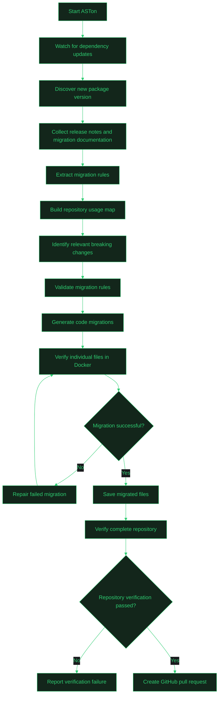
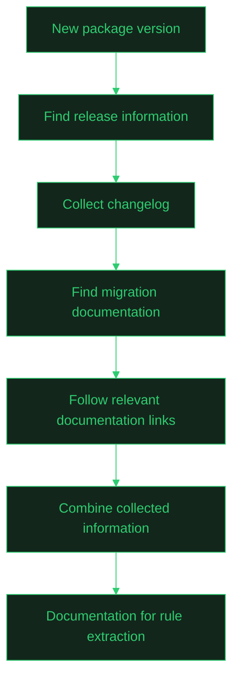
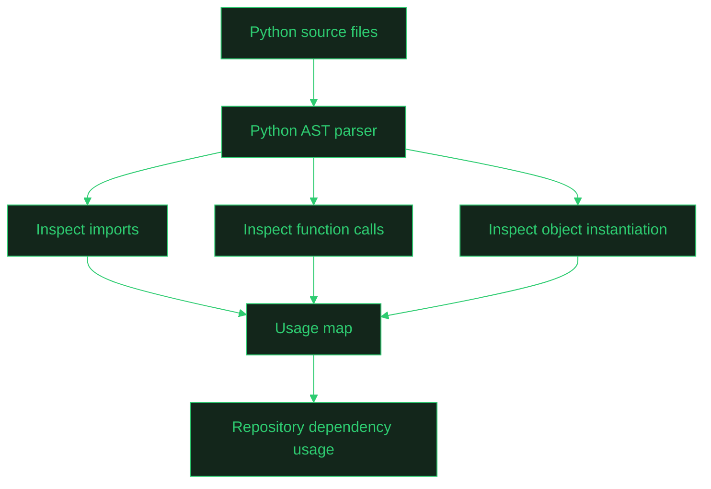
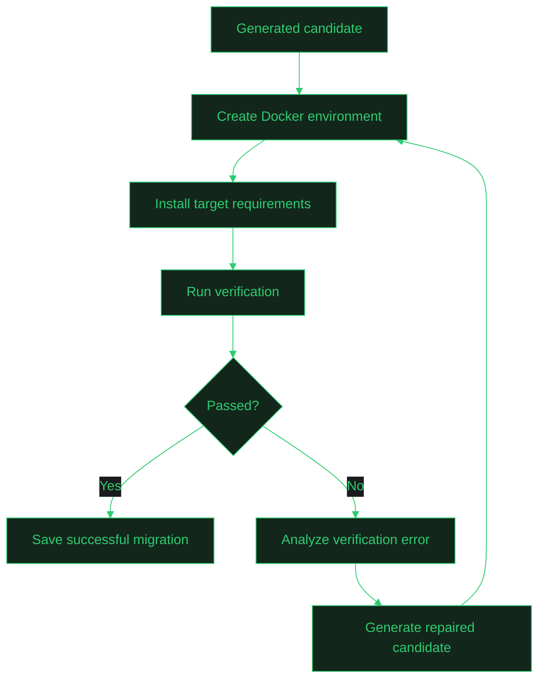
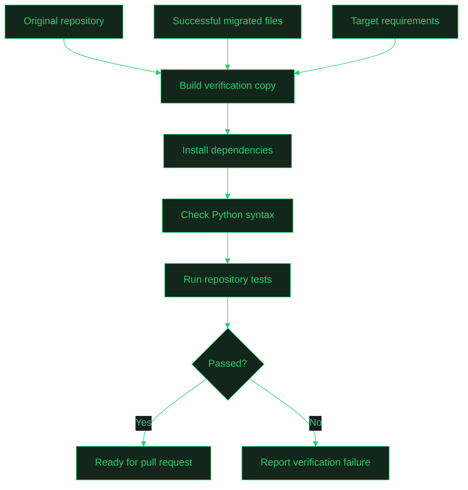
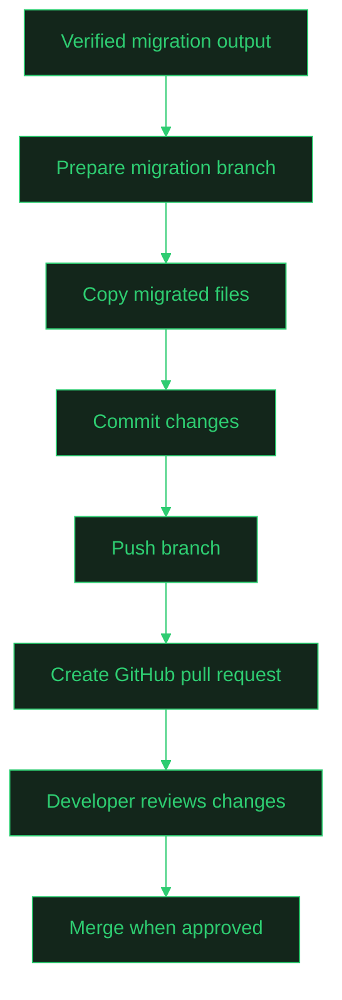
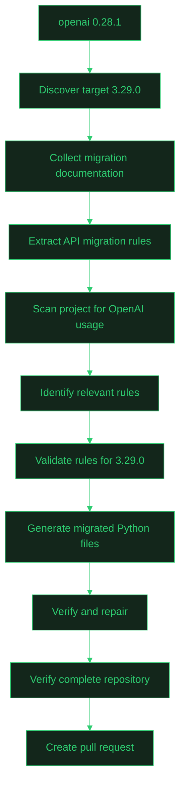

```python


https://github.com/user-attachments/assets/0d83bd42-af21-4fd5-9f7c-4e0ea105f56a


"""
 █████╗ ███████╗████████╗ ██████╗ ███╗   ██╗
██╔══██╗██╔════╝╚══██╔══╝██╔═══██╗████╗  ██║
███████║███████╗   ██║   ██║   ██║██╔██╗ ██║
██╔══██║╚════██║   ██║   ██║   ██║██║╚██╗██║
██║  ██║███████║   ██║   ╚██████╔╝██║ ╚████║
╚═╝  ╚═╝╚══════╝   ╚═╝    ╚═════╝ ╚═╝  ╚═══╝

 ██████╗██╗     ██╗
██╔════╝██║     ██║
██║     ██║     ██║
██║     ██║     ██║
╚██████╗███████╗██║
 ╚═════╝╚══════╝╚═╝
"""
```

### Automated dependency migration, from breaking-change detection to a verified pull request.


**[Quick Start](#quick-start)** •
**[How It Works](#how-it-works)** •
**[Commands](#command-reference)** •
**[Architecture](#project-architecture)** •
**[FAQ](#faq--troubleshooting)** •
**[Contributing](#contributing)**

*Making dependency migrations less manual.*

---

## Table of Contents

<details>
<summary><strong>Click to expand</strong></summary>

1. [The problem ASTon solves](#the-problem-aston-solves)
2. [Quick start](#quick-start)
3. [How it works](#how-it-works)
4. [The 10 stages in detail](#the-10-stages-in-detail)
5. [Command reference](#command-reference)
6. [Run the complete workflow](#run-the-complete-workflow)
7. [Example migration](#example-migration)
8. [Project architecture](#project-architecture)
9. [Generated files and directories](#generated-files-and-directories)
10. [Installation](#installation)
11. [Design principles](#design-principles)
12. [Current scope & roadmap](#current-scope--roadmap)
13. [FAQ & troubleshooting](#faq--troubleshooting)
14. [Contributing](#contributing)

</details>

---

## The problem ASTon solves

Your project uses an older version of a Python library. A new version ships and some APIs change.

```python
# Old API
import openai

openai.ChatCompletion.create(...)
```

```python
# New API
from openai import OpenAI

client = OpenAI()
client.chat.completions.create(...)
```

Simply bumping the version can break your app. Traditionally you would have to:

1. Read release notes and migration guides
2. Find the breaking changes relevant to *your* code
3. Search your codebase for affected APIs
4. Rewrite the affected code
5. Run tests and debug failures
6. Commit and open a pull request

**ASTon automates that entire loop** and hands you a reviewable PR.

---

## Quick start

Three commands, from update detection to pull request:

```bash
aston watcher --path demo          # 1. detect dependency updates
aston check --run --path demo      # 2. run the migration pipeline
aston pr --path aston/succ_migrations --repo demo   # 3. open the PR
```

> Not sure what's available? Run `aston --help` or `aston <command> --help` at any time.

<details>
<summary><strong>Prerequisites checklist</strong></summary>

- [ ] Python installed
- [ ] Docker installed and running
- [ ] Git installed
- [ ] GitHub access (for PR creation)
- [ ] API key for your configured LLM provider
- [ ] A local clone of the target repository (e.g. `demo/`)

</details>

---

## How it works

### The 30-second view

```text
 ┌──────────────────────────────────────────────────────────────────────────┐
 │                         ASTon  MIGRATION PIPELINE                        │
 └──────────────────────────────────────────────────────────────────────────┘

   ① WATCH        ② INGEST         ③ EXTRACT        ④ SCAN
 ┌─────────┐    ┌───────────┐    ┌────────────┐    ┌────────────┐
 │ new pkg │───▶│ changelog │───▶│ LLM builds │───▶│ AST usage  │
 │ version │    │ + guides  │    │ rules.json │    │ map of repo│
 └─────────┘    └───────────┘    └────────────┘    └─────┬──────┘
                                                          │
   ⑧ VERIFY       ⑦ GENERATE       ⑥ VALIDATE       ⑤ RELEVANCE
 ┌──────────┐   ┌────────────┐   ┌────────────┐   ┌──────┴──────┐
 │ Docker   │◀──│ candidate  │◀──│ rules vs   │◀──│ which rules │
 │ per file │   │ migrations │   │ target ver │   │ hit my code?│
 └────┬─────┘   └────────────┘   └────────────┘   └─────────────┘
      │
      ├── fail ──▶ REPAIR ──▶ (back to ⑧)
      │
      └── pass
            │
            ▼
   ⑨ FULL-REPO VERIFY              ⑩ DELIVER
 ┌─────────────────────┐        ┌──────────────────────┐
 │ syntax + test cmd   │──pass─▶│ branch → commit →    │──▶ Human review
 │ on combined project │        │ push → GitHub PR     │       & merge
 └──────────┬──────────┘        └──────────────────────┘
            │
          fail
            ▼
     Verification report
```

### The full workflow (Mermaid)

<details open>
<summary><strong>View the complete migration workflow</strong></summary>



</details>

### Which CLI command runs which stages?

| Command | Stages it drives | Output |
|---|---|---|
| `aston watcher` | ① Dependency monitoring | Detected updates, version state |
| `aston check --run` | ②–⑨ Ingest → extract → scan → relevance → validate → generate → verify → repair → full-repo verify | `succ_migrations/`, `final_reports/` |
| `aston pr` | ⑩ Pull request creation | A GitHub PR for review |

```text
 aston watcher ───▶ aston check --run ───▶ aston pr
   (stage 1)          (stages 2 – 9)        (stage 10)
```

---

## The 10 stages in detail

> Click any stage to expand it.

<details>
<summary><strong>① Dependency monitoring</strong> — find out when a dependency has a newer version</summary>

<br>

ASTon includes a watcher that monitors dependencies and identifies available updates.

```text
Current dependency: openai==0.28.1
Available version:  3.29.0
```

It also keeps version-related state so previously processed updates can be tracked.

**Run it:**

```bash
aston watcher --path demo
```

</details>

<details>
<summary><strong>② Change discovery & documentation ingestion</strong> — understand what changed</summary>

<br>

When an update is detected, ASTon collects:

- Release notes
- Changelogs
- Migration guides
- Relevant documentation links
- Breaking-change discussions and references

It follows relevant links to gather extra migration context, so extraction doesn't rely on version numbers alone.



</details>

<details>
<summary><strong>③ Migration rule extraction</strong> — turn docs into structured rules</summary>

<br>

Documentation is written for humans. ASTon uses an LLM to convert it into structured migration rules:

```json
{
  "package": "openai",
  "old_api": "openai.ChatCompletion.create",
  "new_api": "client.chat.completions.create",
  "migration_type": "rename"
}
```

Rules can describe:

- API renames
- Removed APIs
- Configuration changes
- New instantiation requirements
- Changes in how an API is accessed

> Extracted rules are **not** automatically assumed to be applicable. They are evaluated against the target version first.

</details>

<details>
<summary><strong>④ Repository scanning & usage mapping</strong> — see how your project really uses the library</summary>

<br>

ASTon uses Python's Abstract Syntax Tree (AST) instead of plain text search.

```python
from openai import OpenAI as Client

client = Client()

response = client.chat.completions.create(
    model="example-model",
    messages=[]
)
```

The scanner captures: imported package, imported symbol, local alias, instantiated objects, API usage, source line, and relevant keyword arguments.



</details>

<details>
<summary><strong>⑤ Change relevance analysis</strong> — keep only the rules that matter to you</summary>

<br>

A library can introduce hundreds of changes. Most won't touch your code.

| Extracted change | Used in project? |
|---|---|
| `ChatCompletion.create` changed | Yes |
| `Embedding.create` changed | Yes |
| An unrelated API was removed | No |

The result is a smaller set of potentially relevant migration rules.

</details>

<details>
<summary><strong>⑥ Migration rule validation</strong> — don't apply stale rules</summary>

<br>

A rule that was valid for an earlier upgrade may not be valid for a later one.

```text
Version 0 → Version 1      API A → API B
Version 1 → Version 2      API B → API C
```

Applying the first rule directly to a project targeting Version 2 would leave it on an outdated API. ASTon validates rules against the **target version** before code generation.

Rules that can't be validated are **not** silently treated as confirmed. They remain unresolved for further analysis.

</details>

<details>
<summary><strong>⑦ Code migration generation</strong> — produce candidate code</summary>

<br>

```python
# Before
import openai

response = openai.ChatCompletion.create(...)
```

```python
# After
from openai import OpenAI

client = OpenAI()
response = client.chat.completions.create(...)
```

The output is a **candidate**, not an accepted result. It must pass verification.

</details>

<details>
<summary><strong>⑧ Individual file verification & repair</strong> — Docker-isolated checks</summary>

<br>

Each migrated file is verified inside a Docker container with the target dependency installed. Verification distinguishes between:

- Successful migrations
- Migration errors
- Environment / dependency installation errors
- External service errors
- Timeouts



**Repair process:** the failed candidate plus its real verification feedback are used to attempt a *better* migration, not just repeat the same replacement. Successful files are saved to the migration output directory.

</details>

<details>
<summary><strong>⑨ Full-repository verification</strong> — make sure it all works together</summary>

<br>

Passing per-file checks doesn't guarantee the whole project works (one migrated file may depend on another).

The verification environment combines:

- Original repository files that were not migrated
- Successfully migrated files
- Updated target requirements

Then it runs Python syntax checks and the configured test command.



</details>

<details>
<summary><strong>⑩ GitHub pull request creation</strong> — reviewable delivery</summary>

<br>

The PR contains the migrated files and updated dependency requirements. The original source repository is kept separate from ASTon's output during migration, so you stay in control.



</details>

---

## Command reference

### 1. Check available commands

```bash
aston --help
```

### 2. Start the dependency watcher

```bash
aston watcher --path demo
```

View watcher-specific options:

```bash
aston watcher --help
```

### 3. Run the migration pipeline

```bash
aston check --run --path demo
```

View migration command options:

```bash
aston check --help
```

### 4. Create a GitHub pull request

```bash
aston pr \
  --path aston/succ_migrations \
  --repo demo \
  --branch demo_aston \
  --title "Migrate OpenAI dependency" \
  --body "Automated dependency migration generated and verified by ASTon."
```

View PR command options:

```bash
aston pr --help
```

<details>
<summary><strong>What do the flags mean?</strong></summary>

<br>

| Command | Flag | Meaning |
|---|---|---|
| `aston watcher` | `--path` | Path to the project whose dependencies are monitored |
| `aston check` | `--run` | Execute the migration pipeline |
| `aston check` | `--path` | Path to the project to analyze and migrate |
| `aston pr` | `--path` | ASTon's successful migration output (e.g. `aston/succ_migrations`) |
| `aston pr` | `--repo` | Local clone of the target GitHub repository |
| `aston pr` | `--branch` | Name of the migration branch (optional) |
| `aston pr` | `--title` | Pull request title |
| `aston pr` | `--body` | Pull request description |

> Options can vary between versions. Always confirm with `aston <command> --help`.

</details>

---

## Run the complete workflow

Chain everything in one go. Each command runs **only if the previous one succeeds** (`&&`).

```bash
aston watcher --path demo && \
aston check --run --path demo && \
aston pr \
  --path aston/succ_migrations \
  --repo demo \
  --branch demo_aston \
  --title "Migrate OpenAI dependency" \
  --body "Automated dependency migration generated and verified by ASTon."
```

```text
 ┌──────────────┐  ok   ┌──────────────────┐  ok   ┌────────────┐
 │ aston watcher│──────▶│ aston check --run│──────▶│  aston pr  │──▶ PR opened
 └──────┬───────┘       └────────┬─────────┘       └─────┬──────┘
        │ fail                   │ fail                  │ fail
        ▼                        ▼                       ▼
      stop                  stop                 stop
```

---

## Example migration

Your project uses:

```text
openai==0.28.1
```

You want to move to:

```text
openai==3.29.0
```



Instead of manually hunting down every affected API, you receive a **pull request with the proposed changes**.

---

## Project architecture

<details>
<summary><strong>Main modules</strong></summary>

<br>

| Module | Responsibility |
|---|---|
| `watcher.py` | Monitors dependency updates |
| `poller.py` | Supports checking for available updates |
| `ingestion.py` | Collects release and migration documentation |
| `changes/chain.py` | Handles migration boundaries across versions |
| `axios.py` | Code-generation and related integration logic |
| `scanner.py` | Analyzes Python source code and dependency usage |
| `relevance.py` | Evaluates whether changes affect the repository |
| `rule_validation.py` | Validates migration rules against the target |
| `pipeline.py` | Coordinates migration and repair operations |
| `docker.py` | Verifies individual migrated files |
| `repo_verification.py` | Verifies the complete migrated repository |
| `repo_index/repo_map.py` | Maps the repository and coordinates repository migration |
| `github_integrations/pr.py` | Creates GitHub pull requests |
| `cli/main.py` | Defines the command-line interface |
| `cli/console.py` | Provides CLI messages and output |
| `cli_ui/rich.py` | Provides the Rich terminal interface |

</details>

<details>
<summary><strong>Module → pipeline map</strong></summary>

<br>

```text
 WATCH      watcher.py ── poller.py
   │
 INGEST     ingestion.py ── changes/chain.py
   │
 EXTRACT    axios.py (LLM) ──▶ rules.json
   │
 SCAN       scanner.py ──▶ repo_index/repo_map.py ──▶ repo_index.json
   │
 FILTER     relevance.py ── rule_validation.py
   │
 MIGRATE    pipeline.py ◀──▶ docker.py   (generate ⇄ verify ⇄ repair)
   │
 VERIFY     repo_verification.py
   │
 DELIVER    github_integrations/pr.py

 INTERFACE  cli/main.py ── cli/console.py ── cli_ui/rich.py
```

</details>

---

## Generated files and directories

| Path | Purpose |
|---|---|
| `artifacts/runs/` | Individual migration run artifacts and attempts |
| `succ_migrations/` | Successfully migrated files and target requirements |
| `final_reports/` | Migration analysis and result reports |
| `rule_cache/` | Cached migration-rule information |
| `repo_index.json` | Repository indexing information |
| `migrations.json` | Migration-related information |
| `changes.json` | Collected change information |
| `rules.json` | Extracted migration rules |
| `temp_requirements.txt` | Temporary target requirements used during migration |

---

## Installation

```bash
# 1. Clone
git clone https://github.com/YOUR_USERNAME/ASTon.git
cd ASTon

# 2. Install the project
pip install -e .

# 3. Install dependencies if needed
pip install -r requirements.txt

# 4. Verify the CLI works
aston --help
```

Then configure the environment variables required by your selected **LLM provider** and **GitHub integration**.

---

## Design principles

| # | Principle | Idea |
|---|---|---|
| 1 | **Documentation-driven migration** | Decisions come from real release notes and migration docs |
| 2 | **Repository-aware changes** | Only changes relevant to your usage are considered |
| 3 | **Version-aware validation** | Rules must be compatible with the requested target version |
| 4 | **Verification before acceptance** | Generated code is tested, not trusted because it looks right |
| 5 | **Isolated execution** | Docker isolates dependency installs and verification |
| 6 | **Reviewable delivery** | Migrations arrive as PRs so you control what merges |

---

## Current scope & roadmap

ASTon is under **active development**. The current implementation focuses on **Python** dependency migrations, with the **OpenAI Python SDK** as an important test case.

The architecture separates ingestion, rule extraction, repository analysis, code generation, verification, and delivery, so more packages can be supported without tying the system to one library.

- [x] Dependency watching
- [x] Documentation ingestion & rule extraction
- [x] AST-based repository usage mapping
- [x] Version-aware rule validation
- [x] Docker-isolated per-file verification with repair
- [x] Full-repository verification
- [x] GitHub pull request creation
- [ ] Support for additional Python packages
- [ ] Broader language ecosystem support

---

## FAQ & troubleshooting

<details>
<summary><strong>Does ASTon change my repository directly?</strong></summary>

<br>

No. Migration output is kept separate (in `succ_migrations/`) and only reaches your repo as a pull request that you review and merge.

</details>

<details>
<summary><strong>Why is a rule "unresolved"?</strong></summary>

<br>

Rules that can't be validated against the target version are never silently treated as confirmed. They stay unresolved so they can be analyzed further instead of risking an incorrect migration.

</details>

<details>
<summary><strong>A file failed verification. What now?</strong></summary>

<br>

ASTon sends it through the repair loop, using the real failure output to generate a corrected candidate. Check `artifacts/runs/` for each attempt and `final_reports/` for the result.

</details>

<details>
<summary><strong>Verification failed on dependency installation or timeout.</strong></summary>

<br>

ASTon separates environment, external-service, and timeout failures from true migration errors. Confirm that Docker is running and has network access, then re-run `aston check --run --path demo`.

</details>

<details>
<summary><strong>The full-repository check failed even though every file passed.</strong></summary>

<br>

Individual success doesn't guarantee cross-file compatibility. Review the verification report in `final_reports/` to see whether syntax checks or your configured test command failed.

</details>

<details>
<summary><strong>The <code>aston pr</code> command can't push or create the PR.</strong></summary>

<br>

Check that:

- [ ] `--repo` points to a valid local clone of the target repository
- [ ] Your GitHub credentials/environment variables are configured
- [ ] `--path` points to `aston/succ_migrations` (the successful migration output)
- [ ] You have push access to the repository

</details>

<details>
<summary><strong>A command or flag isn't recognized.</strong></summary>

<br>

Flags can differ between versions. Run `aston --help` and `aston <command> --help` to see what your installed version supports.

</details>

---

## Contributing

Contributions, feedback, and ideas are welcome!

If you hit a migration issue, please include:

- [ ] The dependency and source version
- [ ] The target version
- [ ] The affected code
- [ ] The migration report or verification output

These details make problems far easier to reproduce and investigate.

---

<div align="center">

**ASTon — Making dependency migrations less manual.**

If ASTon saves you time, consider starring the repo.

</div>
